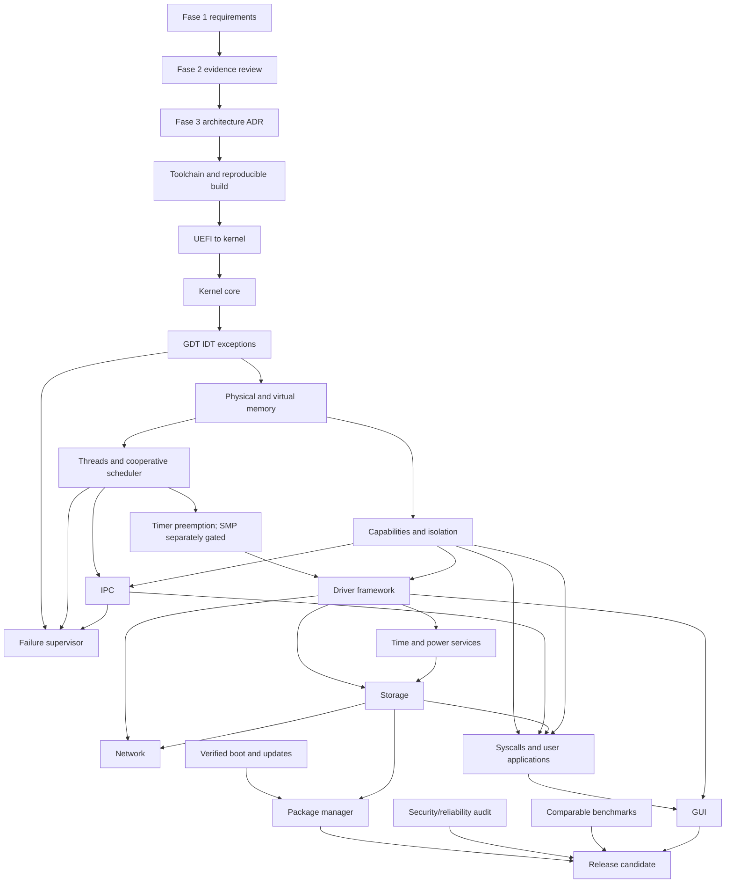

# Architecture dependency graph

Fase 18 (verified boot/update) can proceed as policy/specification in parallel,
but package installation requires its integrity mechanism and actual storage.
Fase 22 is an audit of implemented code and should repeat at milestones. Fase 23
must benchmark only subsystems that exist. The graph indicates dependencies,
not status or guaranteed sequencing; detailed status is in
[`../phase-status.md`](../phase-status.md) and
[`../phase-status-11-20.md`](../phase-status-11-20.md).
