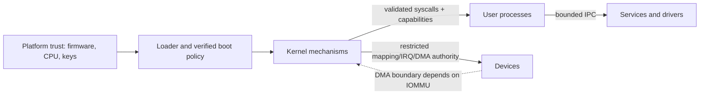

# Security architecture

## Trust boundaries and privilege

The hardware/firmware and signing roots are external trust assumptions. The
loader, kernel, compiler/linker pipeline, root bootstrap task and any key
provisioning process are trusted computing base (TCB) candidates. Ordinary
services, drivers and applications are intended to run at CPL3 once process
isolation exists. Kernel mechanisms run at CPL0. Firmware runtime services are
not planned as a post-boot dependency; current boot exits UEFI boot services.

No user/kernel or IOMMU isolation boundary is currently implemented.

## Authority model

- Object references are process-local unforgeable handles, not pointers or
  global names. Every syscall validates handle generation, object type, rights,
  caller identity and object state.
- Kernel creates the initial capability set for the bootstrap task from an
  explicit boot manifest. A process can create an object only when it holds
  the relevant object-creation authority and resource budget; it cannot mint
  authority from a numeric name or pointer.
- Child processes receive only explicitly selected capabilities with rights
  attenuated to a subset of the parent's. No implicit ambient device or
  filesystem authority is granted.
- Capability transfer over IPC is opt-in and names exact rights. Kernel checks
  that the sender possesses those rights and rejects amplification. Each
  process-local slot has a generation so deletion and slot reuse cannot make a
  stale handle valid.
- Revocation semantics are explicit: deleting a slot revokes that holder's
  handle; object-wide revocation increments the object's generation and
  invalidates all handles referring to that object. Revoking a capability to
  one object does not implicitly revoke capabilities to unrelated objects.
  Implementation must make the invalidation atomic with lookup/transfer.
- Resource limits (CPU budget, memory pages, endpoint queue capacity, handles,
  outstanding requests and pinned/DMA memory) are attached to a process or
  capability and fail with explicit resource errors.
- Drivers receive only assigned BAR/MMIO ranges, IRQ vectors and DMA buffers.
  IOMMU mappings are preferred where hardware/firmware enables a verified unit.
  Without IOMMU, a bus-master device may access memory outside the process
  boundary; do not claim DMA isolation.
- Logs include event type, source identity/generation, monotonic sequence/time
  when available, and result. Security audit logging is bounded and reports
  dropped records; logs are not a substitute for access control.

The kernel derives the caller identity from the executing thread/process; a
message payload cannot authenticate its sender. The early kernel log remains a
bounded emergency channel. A user-mode log service may aggregate events later,
but it cannot be required to report a kernel panic.

## Desired properties and future verification

1. **No authority amplification:** derived/transferred rights are subsets of
   source authority. Model-check capability operations and test every right.
2. **Address-space isolation:** user mappings cannot access supervisor pages or
   another process. Negative page-fault tests and page-table invariant checks.
3. **Kernel/user argument safety:** copies validate canonical range, arithmetic
   overflow, mapped permissions and lifetime. Fuzz syscall parsers.
4. **Device containment:** a driver cannot access unassigned MMIO, IRQ or DMA
   ranges. Test with virtual malicious driver and IOMMU on/off cases.
5. **Revocation/lifecycle:** exit/restart revokes all relevant resources and
   stale handles do not alias reused objects. Stress race tests.
6. **Boot authenticity:** only accepted, signed/versioned components execute
   under a documented key/rollback policy. Test wrong key, corrupt image,
   rollback, missing key and recovery path.

Capabilities do not eliminate implementation bugs, confused deputies, covert
channels, side channels or faulty hardware. Formal verification may target a
small capability/IPC core only after a precise model, invariants and
implementation correspondence are established; it cannot imply the complete
system is proved.
