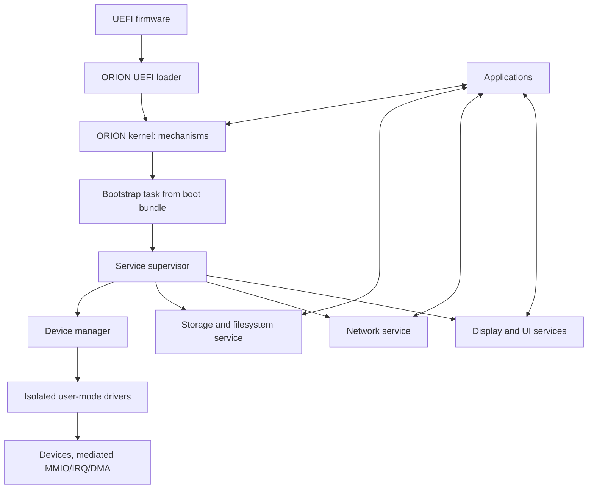

# ORION OS — visão arquitetural do sistema

**Estado:** proposta da Fase 3; não é descrição do código executável atual.
Qualquer elemento marcado como futuro depende dos gates em
[`phase-dependencies.md`](phase-dependencies.md).

## Objetivos e limites

Primeiro alvo: x86-64, firmware UEFI, QEMU/EDK2 para desenvolvimento, C
freestanding e Assembly nas transições de arquitetura. O kernel e o loader são
implementações próprias; especificações públicas podem ser consultadas, código
de implementação de outro kernel não deve ser incorporado. O protótipo atual
apenas transfere controle do firmware ao kernel ELF, valida uma estrutura
limitada de boot, emite serial e entra em `cli; hlt`.

## Arquitetura-base selecionada

O ORION adotará um **microkernel de mecanismos mínimos com autoridade baseada
em capabilities e serviços/drivers em processos de usuário por padrão**. Esta
é a arquitetura-base para orientar interfaces e implementação; não é alegação
de que ela já foi implementada, provada formalmente ou demonstrada superior em
segurança ou desempenho. A escolha e suas alternativas estão registradas em
ADR-0009.

Ring 0 conterá apenas transições de contexto, exceções/interrupções, memória
física e virtual, threads/escalonamento, IPC mínimo, objetos/capabilities,
tempo monotônico e mediação de MMIO/IRQ/DMA. Sistema de arquivos, rede,
política de dispositivos, supervisor, logging normal, compositor e aplicações
ficam fora do kernel. Uma exceção exige ADR próprio, necessidade técnica,
limite de autoridade, evidência de custo e plano de teste.

Os mecanismos de boot permanecem compatíveis com o scaffold existente:
loader UEFI carrega o kernel ELF e entrega boot-info; a criação da primeira
tarefa e do bundle inicial de userland é trabalho futuro e não deve ser
confundida com comportamento atual. A Fase 2 fornece evidência documental útil
para a escolha, mas não benchmarks equivalentes nem cobertura completa de
ameaças. Essa limitação restringe alegações de desempenho e segurança, não
impede a seleção de uma arquitetura-base alinhada aos requisitos do projeto.

## Componentes de alto nível

The diagram is the selected target decomposition, not current runtime
evidence. The bootstrap executable and minimum service bundle must be carried
as boot artifacts rather than loaded through a filesystem service that itself
depends on those artifacts. The signing root, bundle format and first-task
loader contract remain implementation gates. A component running in user mode
still depends on kernel correctness and hardware/IOMMU support.

## Cross-cutting requirements

- Every externally supplied size, address, identifier, message and descriptor
  is checked before use.
- Every resource authority is explicit and bounded by owner, rights, lifetime
  and revocation semantics.
- State transitions must be observable; never report initialization, recovery,
  persistence or support before the operation succeeds.
- Failures in user components may be contained only after address-space and
  resource isolation are implemented. Kernel integrity failure halts or
  reboots under an explicit policy.
- Benchmarks are not architecture evidence until equivalent correctness,
  environment, workload and statistical protocol are documented.

## Implementation status

Only loader→kernel handoff and minimal serial idle are observed. All components
above kernel mechanism are future architecture, not implemented modules. The
architecture is selected as the design baseline; implementation details that
need data (IPC bounds, scheduling quantum and per-device policy) remain
parameterized for their implementation phases.
